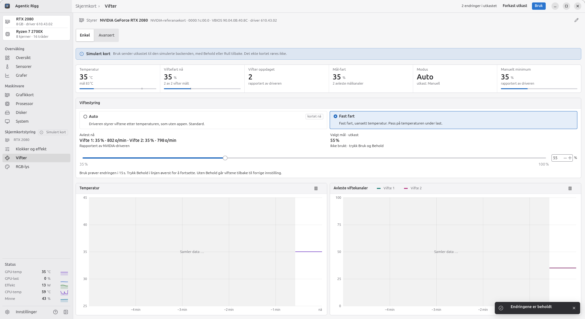
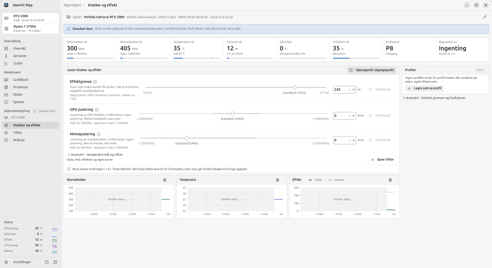
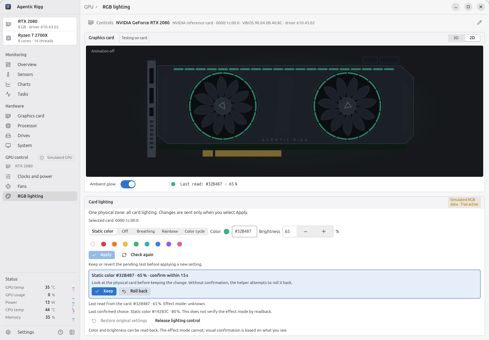

# Agentic HW Monitor

A lightweight Linux hardware monitor with opt-in NVIDIA GPU control, written in Rust and GTK 4. Inspired by MSI Afterburner, HWiNFO, GPU-Z, CPU-Z, CrystalDiskInfo and the Windows Task Manager, Agentic HW Monitor brings sensors, long-term graphs, processes, CPU/GPU specifications, SMART disk health, card-bound GPU tuning and GPU RGB lighting together in one native app with no Electron overhead.

[Latest release](https://github.com/bejulian1/agentic-rigg/releases/latest) · [Changelog](CHANGELOG.md) · [Contributing](CONTRIBUTING.md) · [Security](SECURITY.md) · [Contributors](CONTRIBUTORS.md)

> **Renamed:** The app was called *Agentic Rigg* up to and including 1.6.0. Only the display name changed. The repository, the `agentic-rigg` commands, the app ID `io.github.AgenticRigg` and every path keep their names, so settings, history, logs and an already authorized GPU helper carry over unchanged.

> **Languages:** The interface is available in 11 languages: Norwegian Bokmål, English, German, French, Spanish, Portuguese (Brazil), Italian, Polish, Swedish, Simplified Chinese and Japanese. By default it follows your system language; you can change it under `Settings › General › Language`. Issues and pull requests are welcome in English or Norwegian.

<table>
  <tr><th>Fans</th><th>Clocks &amp; Power</th><th>RGB lighting</th></tr>
  <tr>
    <td><a href="docs/images/vifter.png"></a></td>
    <td><a href="docs/images/klokker.png"></a></td>
    <td><a href="docs/images/rgb.png"></a></td>
  </tr>
</table>

*Real GTK 4 screenshots from private test sessions with simulated hardware data. Click an image for full size.*

## Features

| Page | What it shows |
|---|---|
| Overview | CPU, GPU, RAM, VRAM, disk and network tiles, a status bar for notable events, and graphs from 1 minute to 48 hours |
| Sensors | Live sensor table with min, max and average, sparklines and CSV logging |
| Graphs | Synchronized cursor, pause, CSV export and adaptive axes |
| Tasks | Linux processes with CPU, memory (RSS) and GPU memory, search, sorting, a process tree and confirmed termination (`Ctrl+Shift+Esc`) |
| Graphics card | NVML data: clocks, power, PCIe link, VBIOS, fans, limits and GPU processes, plus a clearly separated reference table |
| Processor | Per-thread clock and load, cache topology, instruction sets, vulnerabilities and launch dates for known models; follows CPU hotplug |
| Disks | SMART/NVMe health via UDisks2, temperature, power-on time, wear, I/O and partitions |
| System | Motherboard, BIOS, memory, operating system and controllers |
| Clocks & Power, Fans | Opt-in NVML control of power limit, core/memory clock offset, temperature target and fans (Simple/Advanced views, curves, drafts and profiles) |
| RGB lighting | Card-bound lighting control for the Palit GeForce RTX 2080 Super JetStream: static colour, off, brightness, breathing, rainbow and colour cycle, with a 2D or 3D card that previews the chosen light |

Readings come from `/proc`, sysfs/DMI, hwmon, UDisks2 and NVIDIA NVML. Available fields depend on your hardware and drivers; anything missing or unsupported is shown as unknown rather than made up. Reference data is kept separate from live measurements.

## Requirements and verified platform support

- **Prebuilt release:** Ubuntu 26.04 (`amd64`), GTK ≥ 4.22, glibc ≥ 2.39. Older releases are not verified.
- **GPU:** NVIDIA GPUs via NVML (`libnvidia-ml.so.1`, part of the NVIDIA driver). **AMD and Intel GPU backends are not implemented.** Without an NVIDIA driver, the CPU, memory, disk and system views still work.
- **RGB lighting:** only the Palit GeForce RTX 2080 Super JetStream (Palit 100 controller) is supported. Other cards show an empty state; the app never scans for or writes to unknown I2C devices.
- **Desktop:** developed on Ubuntu / GNOME / Wayland. The optional tray icon needs GNOME's AppIndicator extension (enabled by default on Ubuntu).
- **Building from source:** Rust ≥ 1.92 (edition 2024), `cargo`, `pkgconf`, `libglib2.0-dev-bin`, `libgtk-4-dev` (`gtk4 >= 4.22`) and Python ≥ 3.11 (used at build time to embed the translation catalogs). The NVIDIA driver is not needed to build.

## Installation

### From a GitHub release

Download the archive and `SHA256SUMS` from the [latest release](https://github.com/bejulian1/agentic-rigg/releases/latest), then:

```bash
sha256sum --check SHA256SUMS
tar -xzf agentic-rigg-*.tar.gz
cd agentic-rigg-*/
./install.sh --bin-dir "$PWD/bin"
~/.local/bin/agentic-rigg
```

### From source

```bash
git clone https://github.com/bejulian1/agentic-rigg.git
cd agentic-rigg
./install.sh
```

`install.sh` checks the build packages, compiles into `${CARGO_TARGET_DIR:-$HOME/.cache/rigg-build}` and installs for the current user.

### What the user install does

- **No `sudo`:** everything goes under `~/.local` (binaries, icons, the menu entry and the user service `agentic-riggd.service`). Existing settings and history are kept.
- **Nothing starts at login by default.** The window starts the background service on demand; background recording and autostart can be enabled under `Settings › General`.
- **No GPU or RGB access.** Monitoring needs no privileges. Hardware control requires the separate system installation below.
- **Updating:** close the app and run `./install.sh` again from a new archive or after `git pull`.
- **Uninstalling:** turn off GPU control and card lighting in the app first, then run `./uninstall.sh`. It keeps your settings (`~/.config/agentic-rigg/`) and history (`~/.local/state/agentic-rigg/`), and refuses to continue while a root helper is still active.

### Optional: system components for GPU control and RGB lighting

GPU control and RGB lighting run in small root helpers. Like MSI Afterburner's driver on Windows, they are installed with one administrator approval. Turn on **Allow GPU tuning** under `Settings › GPU control`, or press **Enable card lighting…** on the RGB lighting page, and enter the administrator password once. If the helpers are missing or outdated, the installer, running as root:

1. downloads the release matching the app's own version from GitHub into a new root-owned directory,
2. verifies it against the SHA-256 checksum GitHub publishes for that exact file (the one shown on the release page),
3. only then runs the installer from that verified copy, and enables the access you asked for in the same step.

Nothing from your home directory is executed as root. Without a network connection, the same steps are available as a terminal command under *Offline: use a terminal*, where you give the archive path and the SHA-256 yourself.

Each enable/disable action asks for the administrator password through polkit; the authorization is not remembered. To remove everything later: turn off both helpers in the app, then run `sudo /usr/local/libexec/agentic-rigg-system/system-install --uninstall` and `./uninstall.sh`.

Building the system components from source and the trust model are described in [docs/produksjon/rgb-hjelper.md](docs/produksjon/rgb-hjelper.md) and [docs/produksjon/hjelper-sikkerhet.md](docs/produksjon/hjelper-sikkerhet.md) (Norwegian).

## Safety model for GPU control and RGB

- **Card-bound helpers.** Each helper is bound to the selected GPU by PCI address and NVML UUID and checks that identity before every write. It accepts only a fixed set of operations from your own user (checked with `SO_PEERCRED`) over a private socket. Requests with duplicate or unknown fields are rejected.
- **Apply, then Keep.** Edits are drafts until you press **Apply**. Unless you press **Keep** within the deadline (15 s), the helper rolls back automatically. Lost heartbeats, a closed app, sleep gaps and stopping the service also trigger a rollback.
- **Saved starting point.** Before the first change, the helper records the card's own settings (GPU) or a static colour you confirmed by looking at the card (RGB). **Restore** returns to that starting point. Failed or unverifiable restores lock further changes and are reported as they are.
- **RGB specifics.** The RGB helper identifies the Palit controller by its PCI device, NVIDIA I2C port, sysfs path and controller signature, never by bus number. Its systemd sandbox can open only that one I2C device. Effects are computed in the helper and sent as plain colour writes; an external colour change stops an animation. Because the effect mode cannot be read back, the final restore asks you to confirm what you see.
- **Not changed by the app:** CPU, motherboard fans, kernel modules and system packages.

### What has been verified on hardware

- **GPU control (RTX 2080, NVML):** these writes were verified with fresh readback and restore:
  - power limit 245 → 240 W
  - both fans to 50 %
  - core offset −15 MHz and memory offset −10 MHz
  - a flat 50 % fan curve
  - temperature target 83 → 82 °C
  - Keep, reset and the 10 s timeout rollback through the daemon
- **RGB (Palit RTX 2080 Super JetStream):** a static blue at 100 % brightness was applied and automatically restored to the original green. The user confirmed both visually.
- **Not verified:** extreme limits, positive overclocking, stress tests, driver crashes, power loss, automatic Zero RPM, other NVIDIA models, and other RGB controllers.

## Architecture

The Rust workspace is in [`app/`](app/):

| Crate | Binary | Responsibility |
|---|---|---|
| [`rigg`](app/crates/rigg) | `agentic-rigg` | GTK 4 user interface. Never loads NVML and never talks to the root helpers directly. |
| [`riggd`](app/crates/riggd) | `agentic-riggd` | Unprivileged user daemon: NVML, `/proc`, `/sys`, hwmon, UDisks2, processes, 48 h history, CSV logging, alerts, the tray icon and the per-user socket. |
| [`rigg-helper`](app/crates/rigg-helper) | `agentic-rigg-helper` | Optional, card-bound root helper for NVML writes and, as a separate service, Palit RGB. Minimal dependencies. |
| [`rigg-core`](app/crates/rigg-core) | — | Data model, IPC protocol, history, settings, formatting, translations (`i18n`) and helper compatibility checks. |
| [`rigg-hw`](app/crates/rigg-hw) | — | Hardware readers and writers, plus a simulated backend used only by isolated tests. |

Translations are gettext `.po` catalogs under [`app/data/i18n/`](app/data/i18n/), embedded into the binaries at build time. See [CONTRIBUTING.md](CONTRIBUTING.md#translations) to improve a translation or add a language.

## Privacy

Everything runs locally. The app sends no telemetry or crash reports and never connects to the network on its own. The only network access is when you press **Install system components**: the administrator installer then downloads that release from GitHub. CSV logs and reports are written only where you choose. Hardware serial numbers and UUIDs are hidden in exported reports unless you opt in.

## Status and roadmap

See [CHANGELOG.md](CHANGELOG.md) for the release history. Known limits and ideas:

- AMD and Intel GPU backends.
- More RGB controllers. Each needs its own controller identification and an explicit hardware test.
- Per-process GPU utilisation in Tasks (GPU memory is shown today).
- RAM module (SPD), display and network adapter details. Motherboard sensor kernel modules (`nct6775` etc.) are not loaded by the app.

## Contributing

Contributions are welcome. [CONTRIBUTING.md](CONTRIBUTING.md) covers build setup, test isolation, hardware-safety rules, translations and the pull request checklist. Participation follows the [Code of Conduct](CODE_OF_CONDUCT.md).

## Security

Please report vulnerabilities privately via [GitHub Security Advisories](https://github.com/bejulian1/agentic-rigg/security/advisories/new). See [SECURITY.md](SECURITY.md).

## License

[MIT](LICENSE). UI icons are from [Lucide](https://lucide.dev) (ISC) with some [Feather](https://feathericons.com) icons (MIT). Third-party notices are in [app/data/LISENSER.md](app/data/LISENSER.md) and ship with the release packages.

## Credits

Created by [Julian / bejulian1](https://github.com/bejulian1), with AI assistance from Anthropic Claude (Claude Code), OpenAI GPT (Codex) and Google Gemini. See [CONTRIBUTORS.md](CONTRIBUTORS.md) for who did what.
