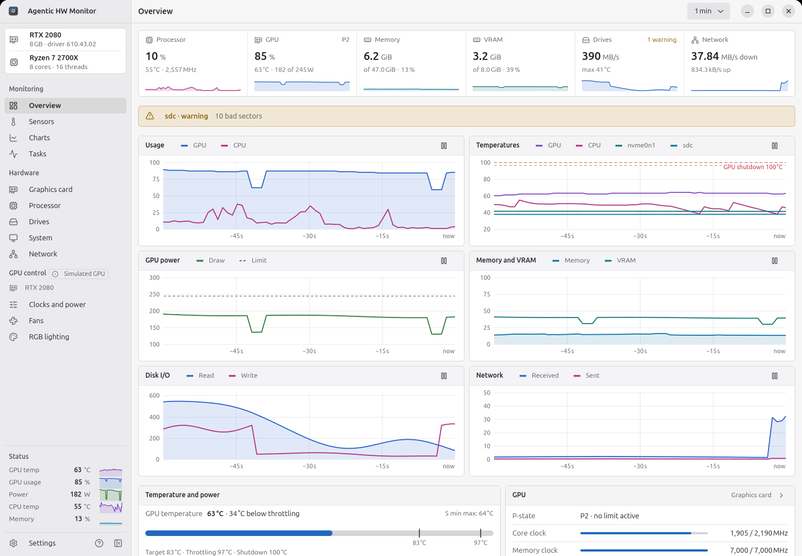
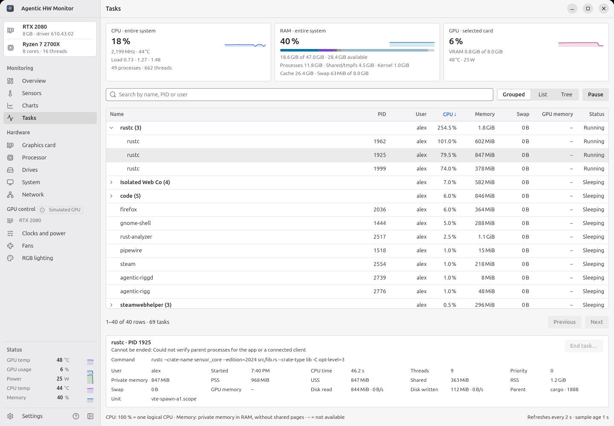
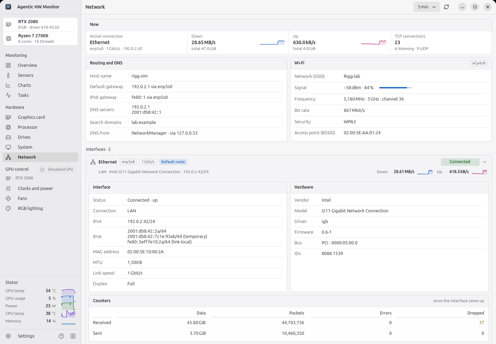
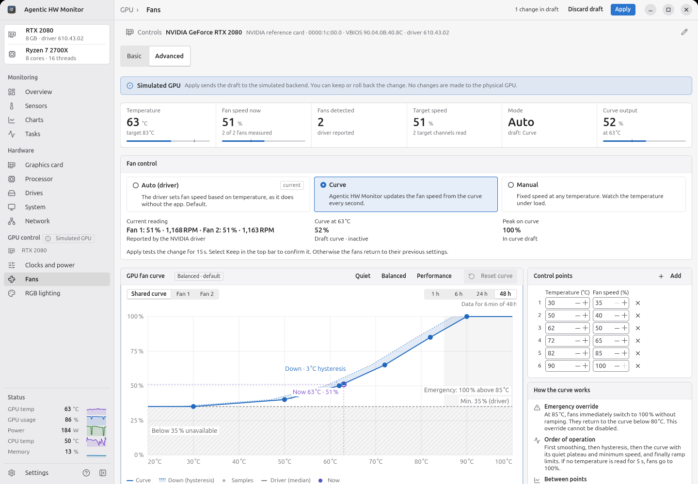
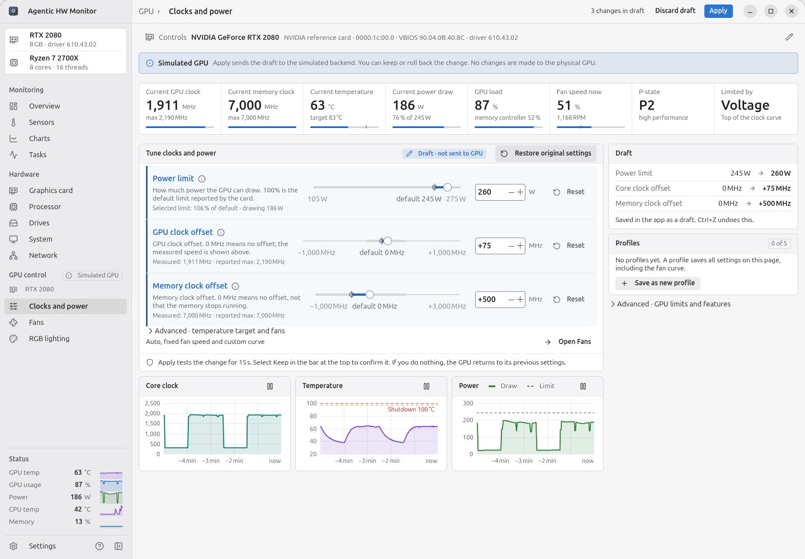
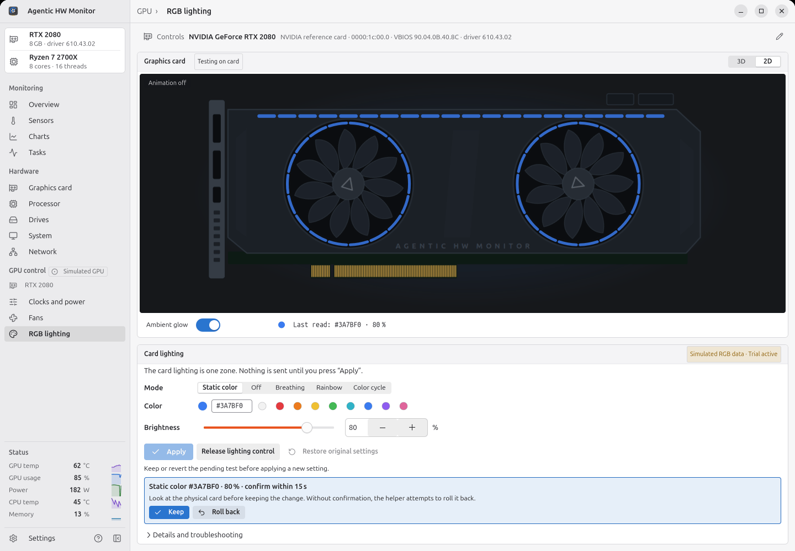
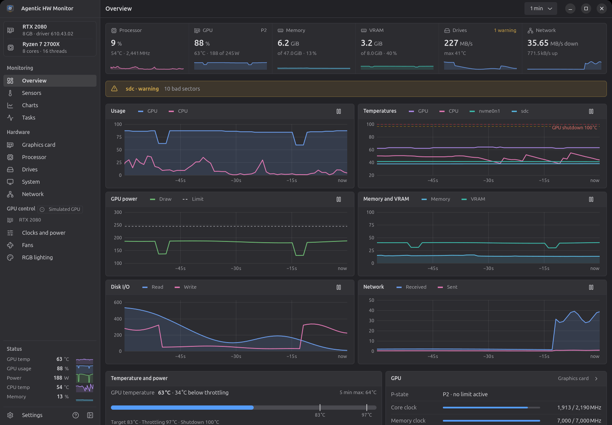

# Agentic HW Monitor

Agentic HW Monitor is a native hardware monitor for Linux desktops, written in Rust and GTK 4. It shows sensors, load and temperature graphs, running tasks, network connections, CPU and GPU specifications and disk health in one window. On NVIDIA cards it can also adjust the power limit, clock offsets and fan curve, and on one supported Palit card it controls the RGB lighting. Monitoring needs no privileges; GPU and lighting control are opt-in and run through a small card-bound helper.

It is meant for people who use Linux on a desktop PC and want what tools like MSI Afterburner, HWiNFO, GPU-Z and the Windows Task Manager offer on Windows: gamers checking temperatures and clocks under load, people building or tuning a PC, and anyone who wants to know what their machine is doing without opening several terminal tools.

[Latest release](https://github.com/bejulian1/agentic-rigg/releases/latest) · [Changelog](CHANGELOG.md) · [Contributing](CONTRIBUTING.md) · [Security](SECURITY.md) · [Contributors](CONTRIBUTORS.md)

<a href="docs/images/overview.png"></a>

> **Renamed:** Up to and including 1.6.0 the app was called *Agentic Rigg*. Only the display name changed. The repository, the `agentic-rigg` commands, the app ID `io.github.AgenticRigg` and all paths are unchanged, so settings, history, logs and an authorized GPU helper carry over.

## Contents

- [Features](#features)
- [Screenshots](#screenshots)
- [Requirements](#requirements)
- [Install](#install)
- [Upgrade](#upgrade)
- [GPU control and RGB lighting](#gpu-control-and-rgb-lighting)
- [Safety model for GPU control](#safety-model-for-gpu-control)
- [Architecture](#architecture)
- [Privacy](#privacy)
- [Status and roadmap](#status-and-roadmap)
- [Contributing, security and license](#contributing-security-and-license)

## Features

| Page | What it shows |
|---|---|
| Overview | CPU, GPU, RAM, VRAM, drive and network tiles, a status bar for warnings, and graphs from 1 minute to 48 hours |
| Sensors | Live sensor table with min, max and average, sparklines and CSV logging |
| Charts | Synchronized cursor, pause, CSV export, and temperature axes that always reach at least 100 °C |
| Tasks | Processes grouped by app or as a list or tree, with CPU, private memory, swap and GPU memory; a detail panel with command line, start time, CPU time, PSS/USS, disk I/O and systemd unit; a RAM breakdown; confirmed termination (`Ctrl+Shift+Esc`) |
| Graphics card | NVML data: clocks, power, PCIe link, VBIOS, fans, limits and GPU processes, with reference data kept separate |
| Processor | Per-thread clock and load, cache topology, instruction sets, vulnerabilities and launch dates for known models; follows CPU hotplug |
| Drives | SMART/NVMe health via UDisks2, temperature, power-on time, wear, I/O and partitions |
| Network | Active connection, current and total traffic, routing and DNS, Wi-Fi signal, frequency and security, one expandable row per interface with addresses, hardware, counters and a graph, and listening ports |
| System | Motherboard, BIOS, memory, operating system and controllers |
| Clocks & Power, Fans | Opt-in NVML control of power limit, core and memory clock offsets, temperature target and fans: Basic and Advanced views, fan curves with hysteresis, drafts and profiles |
| RGB lighting | Card-bound lighting control for the Palit GeForce RTX 2080 Super JetStream: a card lighting switch, static colour with a colour picker, breathing, rainbow and colour cycle, and brightness. Off holds while the app runs, and a static colour or off can be kept after the app closes. A 2D or 3D card previews the choice |

Readings come from `/proc`, sysfs/DMI, hwmon, UDisks2, NetworkManager and NVIDIA NVML. What is available depends on your hardware and drivers. Missing or unsupported values are shown as unknown, never estimated.

**Languages:** the interface is available in 11 languages: Norwegian Bokmål, English, German, French, Spanish, Portuguese (Brazil), Italian, Polish, Swedish, Simplified Chinese and Japanese. It follows the system language by default; change it under `Settings › General › Language`.

## Screenshots

All screenshots are real GTK 4 windows from private test sessions with **simulated data**: a simulated RTX 2080 under game load, simulated drives and network interfaces (documentation addresses), and an invented process list. Click an image for full size.

<table>
  <tr><th>Tasks</th><th>Network</th></tr>
  <tr>
    <td><a href="docs/images/tasks.png"></a></td>
    <td><a href="docs/images/network.png"></a></td>
  </tr>
  <tr><th>Fans</th><th>Clocks &amp; Power</th></tr>
  <tr>
    <td><a href="docs/images/fans.png"></a></td>
    <td><a href="docs/images/clocks-power.png"></a></td>
  </tr>
  <tr><th>RGB lighting</th><th>Overview, dark theme</th></tr>
  <tr>
    <td><a href="docs/images/rgb-lighting.png"></a></td>
    <td><a href="docs/images/overview-dark.png"></a></td>
  </tr>
</table>

## Requirements

- **Prebuilt release:** Ubuntu 26.04 (`amd64`) with GTK ≥ 4.22 and glibc ≥ 2.39. Other distributions and older Ubuntu releases are not verified.
- **GPU:** NVIDIA GPUs through NVML (`libnvidia-ml.so.1`, part of the NVIDIA driver). **AMD and Intel GPU backends are not implemented.** Without an NVIDIA driver, the CPU, memory, drive, network and system pages still work.
- **RGB lighting:** only the Palit GeForce RTX 2080 Super JetStream (Palit 100 controller). Other cards show an empty state; the app never scans or writes to unknown I2C devices.
- **Desktop:** developed on Ubuntu with GNOME on Wayland. The optional tray icon needs GNOME's AppIndicator extension, which Ubuntu enables by default.
- **Building from source:** Rust ≥ 1.92 (edition 2024), `cargo`, `pkgconf`, `libglib2.0-dev-bin`, `libgtk-4-dev` (`gtk4 >= 4.22`) and Python ≥ 3.11 (used at build time to embed the translation catalogs). The NVIDIA driver is not needed to build.

## Install

The normal install is per user and needs no `sudo`. It gives you all the monitoring pages. GPU control and RGB lighting are added later, from inside the app, if you want them (see [GPU control and RGB lighting](#gpu-control-and-rgb-lighting)).

### From a GitHub release

Download the `.tar.gz` archive and `SHA256SUMS` from the [latest release](https://github.com/bejulian1/agentic-rigg/releases/latest), then run:

```bash
sha256sum --check SHA256SUMS
tar -xzf agentic-rigg-*.tar.gz
cd agentic-rigg-*/
./install.sh --bin-dir "$PWD/bin"
```

Start the app from the application menu (*Agentic HW Monitor*) or with `~/.local/bin/agentic-rigg`.

### From source

```bash
git clone https://github.com/bejulian1/agentic-rigg.git
cd agentic-rigg
./install.sh
```

`install.sh` checks the build packages, compiles into `${CARGO_TARGET_DIR:-$HOME/.cache/rigg-build}` and installs for the current user.

### What the user install does

- Everything goes under `~/.local`: the binaries, icons, the menu entry and the user service `agentic-riggd.service`.
- **Nothing starts at login by default.** The window starts the background service when it needs it. Background recording and autostart can be turned on under `Settings › General`.
- **No GPU or RGB access.** Monitoring needs no privileges.

### Uninstall

Turn off GPU control and card lighting in the app first, then run `./uninstall.sh` from the release folder or the source checkout. It keeps your settings (`~/.config/agentic-rigg/`) and history (`~/.local/state/agentic-rigg/`), and refuses to continue while a root helper is still active. To remove the system components as well, run `sudo /usr/local/libexec/agentic-rigg-system/system-install --uninstall` after turning both helpers off.

## Upgrade

1. Close the app (and quit it from the tray icon if background recording is on).
2. Download and verify the new release as above, then run `./install.sh --bin-dir "$PWD/bin"` from the new folder. From source: `git pull` and `./install.sh`.
3. Start the app again. Settings, history, logs and profiles are kept.

**Upgrading from build 32 or 33.** In this development version, open **Settings › GPU control** and choose **Update system components** to authorize the expanded scope for the selected card. If only lighting was enabled, use **Allow GPU tuning** in the same place. Migration preserves the saved lighting, factory reference and any unresolved lighting journal. You can resolve it after the workers start.

## GPU control and RGB lighting

**Allow GPU tuning** authorizes power, fans, clocks and temperature targets supported by the selected GPU. On a supported Palit RTX 2080 Super JetStream with a PALIT 100 controller, the same switch also authorizes card lighting. The permission binds your user account to the card's PCI address and GPU UUID. Disabling it stops both workers, including active effects and Hold.

Activation or update uses one administrator approval. The installer fetches the matching GitHub release into a root-owned directory and checks its identity and SHA-256 before running its installer. Release installations also pin the hashes of individual system files. Settings provides an offline option that takes the archive and its independently obtained SHA-256. [Installation and trust model](docs/produksjon/rgb-hjelper.md)

At boot, a coordinator discovers the current device numbers. The NVML worker receives the NVIDIA control node and the bound GPU. The lighting worker receives only the validated NVIDIA I2C adapter. A delayed adapter can become available after GPU control starts.

Open **RGB lighting** to confirm the first steady reading. After a crash or a change to the lighting during reboot, compare the observed light, saved setting and factory reference. Restore the saved setting, or visually confirm the steady light on the card and keep it. These actions use the worker socket. The old journal is archived when you keep the observed light, and your saved preference remains available.

## Safety model for GPU control

Changing clocks, power and fans can make a card unstable, so every write goes through the same rules:

- **Card-bound helper.** The helper is bound to one GPU by PCI address and NVML UUID and checks that identity before every write. It accepts a fixed set of operations, only from your own user (checked with `SO_PEERCRED`) over a private socket, and rejects requests with duplicate or unknown fields. Values outside the limits the card reports are rejected.
- **Draft, Apply, Keep.** Changes are drafts until you press **Apply**. Unless you press **Keep** within 15 seconds, the helper rolls back on its own. Lost heartbeats, a closed app, a sleep gap or a stopped service also roll back. Deadlines follow a monotonic clock, so changing the system time does not affect them.
- **Saved starting point.** Before the first change the helper records the card's own settings. **Restore original settings** returns to them. A restore that fails or cannot be verified locks further changes and is reported as it is.
- **Thermal protection.** Above 85 °C the fans go to 100 %, and the curve cannot turn this off. If a restore has failed, the helper keeps reading the temperature and retries the card's defaults with automatic fans.
- **RGB.** The RGB helper is a separate service with a device-specific sandbox. It finds the Palit controller by PCI device, NVIDIA I2C port, sysfs path and controller signature, never by bus number, and its systemd sandbox can open only that one I2C device. Because the effect mode cannot be read back, the final restore asks you to confirm what you see on the card.
- **Out of scope:** the app does not change the CPU, motherboard fans, kernel modules or system packages.

### Verified on hardware

- **GPU control (RTX 2080, NVML):** power limit 245 → 240 W, both fans to 50 %, core offset −15 MHz and memory offset −10 MHz, a flat 50 % fan curve, temperature target 83 → 82 °C, and Keep, reset and the timeout rollback through the daemon. Each write was verified by reading it back and restoring.
- **RGB (Palit RTX 2080 Super JetStream):** a static blue at 100 % brightness was applied and automatically restored to the original green, confirmed visually by the user.
- **Not verified:** extreme limits, positive overclocking, stress tests, driver crashes, power loss, automatic Zero RPM, other NVIDIA models and other RGB controllers. The safety fixes in 1.6.0 have been tested against simulated cards only.

## Architecture

The Rust workspace is in [`app/`](app/):

| Crate | Binary | Responsibility |
|---|---|---|
| [`rigg`](app/crates/rigg) | `agentic-rigg` | GTK 4 user interface. Never loads NVML and never talks to the root helpers directly. |
| [`riggd`](app/crates/riggd) | `agentic-riggd` | Unprivileged user daemon: NVML, `/proc`, `/sys`, hwmon, UDisks2, NetworkManager, processes, 48 h history, CSV logging, alerts, the tray icon and the per-user socket. |
| [`rigg-helper`](app/crates/rigg-helper) | `agentic-rigg-helper` | Optional, card-bound root helper for NVML writes and, as a separate service, Palit RGB. Minimal dependencies. |
| [`rigg-core`](app/crates/rigg-core) | — | Data model, IPC protocol, history, settings, formatting, translations (`i18n`) and helper compatibility checks. |
| [`rigg-hw`](app/crates/rigg-hw) | — | Hardware readers and writers, plus a simulated backend used only by isolated tests. |

Translations are gettext `.po` catalogs under [`app/data/i18n/`](app/data/i18n/), embedded into the binaries at build time. See [CONTRIBUTING.md](CONTRIBUTING.md#translations) to improve a translation or add a language.

## Privacy

Everything runs locally. The app sends no telemetry or crash reports and does not connect to the network on its own. The only network access is when you enable GPU control or card lighting and the helpers need to be installed or updated: the administrator installer then downloads that release from GitHub. CSV logs and reports are written only where you choose. Hardware serial numbers and UUIDs are hidden in exported reports unless you opt in.

## Status and roadmap

See [CHANGELOG.md](CHANGELOG.md) for the release history (in Norwegian) and the [Releases](https://github.com/bejulian1/agentic-rigg/releases) page for downloads and release notes. Known limits and ideas:

- AMD and Intel GPU backends.
- More RGB controllers. Each needs its own controller identification and an explicit hardware test.
- Per-process GPU utilisation in Tasks (GPU memory is shown today).
- RAM module (SPD) and display details. Motherboard sensor kernel modules (`nct6775` and others) are not loaded by the app.
- Signed `SHA256SUMS` for releases (issue #19).

## Contributing, security and license

Contributions are welcome, in English or Norwegian. [CONTRIBUTING.md](CONTRIBUTING.md) covers build setup, test isolation, hardware-safety rules, translations and the pull request checklist. Participation follows the [Code of Conduct](CODE_OF_CONDUCT.md).

Please report vulnerabilities privately through [GitHub Security Advisories](https://github.com/bejulian1/agentic-rigg/security/advisories/new). See [SECURITY.md](SECURITY.md).

[MIT](LICENSE). UI icons are from [Lucide](https://lucide.dev) (ISC) with some [Feather](https://feathericons.com) icons (MIT). Third-party notices are in [app/data/LISENSER.md](app/data/LISENSER.md) and ship with the release packages.

## Credits

Created by [Julian / bejulian1](https://github.com/bejulian1), with AI assistance from Anthropic Claude (Claude Code), OpenAI GPT (Codex) and Google Gemini (Antigravity). See [CONTRIBUTORS.md](CONTRIBUTORS.md) for who did what.
