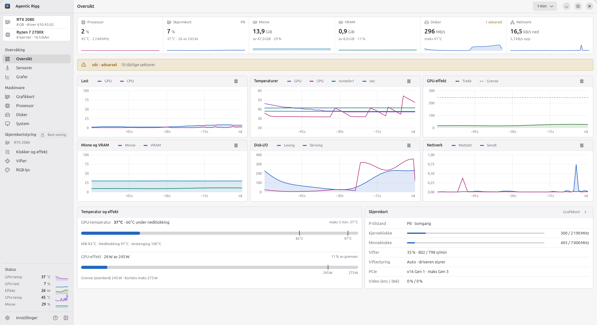
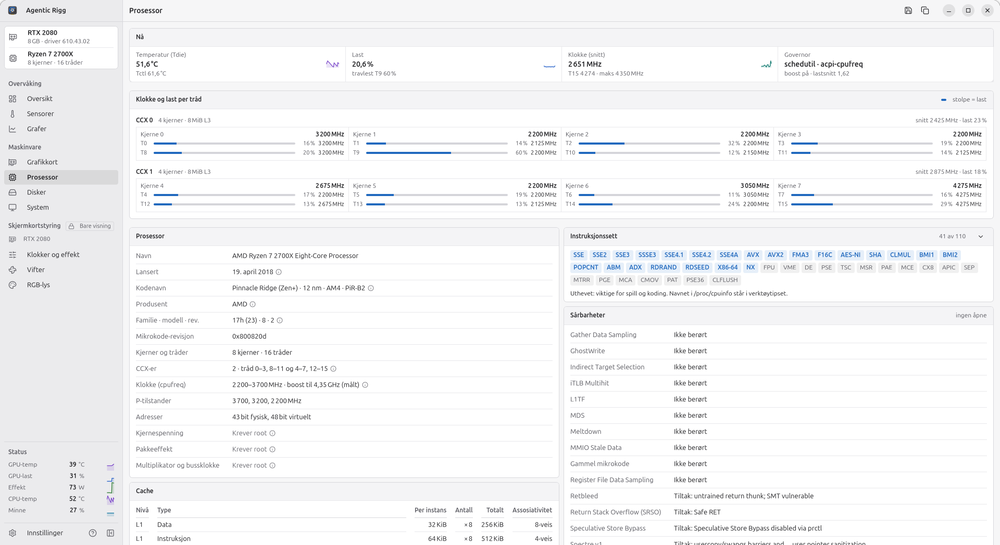
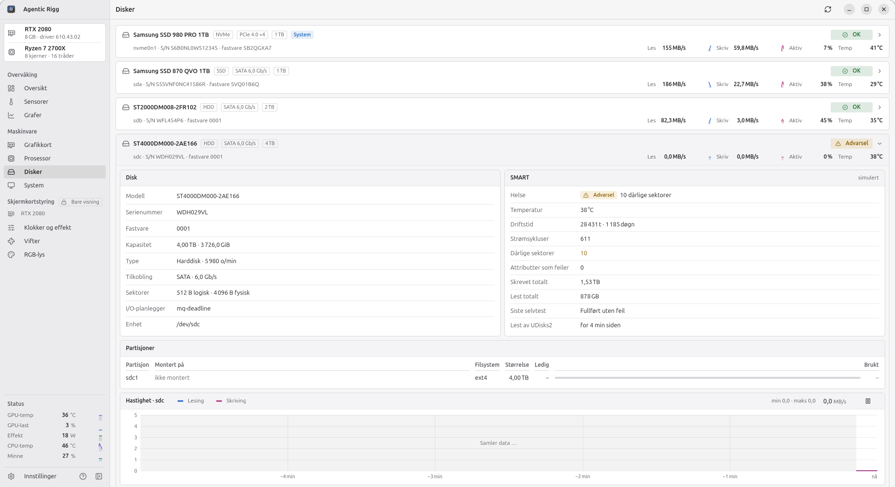

# Agentic Rigg

**1.3.3 · bygg 22** · Rust og GTK 4 · Ubuntu · Code Pro

Et lett maskinvareverktøy for Ubuntu: sensorer, grafer, CPU- og GPU-spesifikasjoner og diskhelse i én norsk desktop-app. Inspirert av MSI Afterburner, HWiNFO, GPU-Z, CPU-Z og CrystalDiskInfo.

[Last ned siste utgave](https://github.com/bejulian1/agentic-rigg/releases/latest) · [Versjonslogg](CHANGELOG.md) · [Bidragsytere](CONTRIBUTORS.md)

<table>
  <tr><th>Oversikt</th><th>Prosessor</th><th>Disker og SMART</th></tr>
  <tr>
    <td><a href="docs/images/oversikt.png"></a></td>
    <td><a href="docs/images/prosessor.png"></a></td>
    <td><a href="docs/images/disker.png"></a></td>
  </tr>
</table>

*Skjermbilder fra GTK-appen 1.3.3 i en testøkt. Skjermkort- og diskdata er simulerte. Klikk på bildene for full størrelse.*

## Nytt i 1.3.3

- CPU-lanseringsdato med produsent som kilde; Ryzen 7 2700X viser 19. april 2018.
- Alle forbedringene fra 1.3.1 og 1.3.2: ryddigere sidefelt og kortmeny, direkte navigasjon til Grafikkort, bedre innstillingssøk og adaptive måleakser.
- Gjennomgang av komponentenes spesifikasjoner og videre forbedringsbehov.

**Ekte GPU-styring er fortsatt låst.** Klokker, effekt og viftekurver kan redigeres som utkast og profiler. RGB er en forhåndsvisning; denne utgaven endrer ikke kortets innstillinger.

## Hva appen viser

| Side | Innhold |
|---|---|
| Oversikt | CPU, GPU, RAM, VRAM, disker og nettverk; tilstand og grafer fra ett minutt til 48 timer |
| Sensorer | Måleverdier med min, maks og snitt, sparklinjer og CSV-logging |
| Grafer | Felles markør, pause, eksport og adaptive akser |
| Grafikkort | NVML-data: klokker, effekt, PCIe, VBIOS, vifter, grenser og prosesser; separat referansetabell |
| Prosessor | Klokke og last per tråd/kjerne, cache, instruksjonssett, sårbarheter og lanseringsdato for kjente modeller |
| Disker | SMART/NVMe-helse, temperatur, driftstid, slitasje, I/O og partisjoner |
| System | Hovedkort, BIOS, minnebruk, operativsystem og kontrollere |
| Skjermkortstyring | Utkast/profiler for klokker, effekt og vifter; RGB-forhåndsvisning |

Tilgjengelige felt avhenger av komponentene og driverne. Referanseopplysninger er merket og skal ikke forveksles med målinger. RAM-moduldetaljer, skjerminformasjon og nettverkskortets spesifikasjoner er områder for videre utvidelse.

## Last ned og installer

Den ferdigbygde pakken ligger under [Releases](https://github.com/bejulian1/agentic-rigg/releases). Den er laget for **Ubuntu 26.04, amd64/x86-64, GTK ≥ 4.22 og glibc ≥ 2.39**. Eldre Ubuntu-utgaver er ikke bekreftet støttet.

Last ned `agentic-rigg-1.3.3-build22-ubuntu26.04-amd64.tar.gz` og `SHA256SUMS` fra samme Release:

```bash
sha256sum --check SHA256SUMS
tar -xzf agentic-rigg-1.3.3-build22-ubuntu26.04-amd64.tar.gz
cd agentic-rigg-1.3.3
./install.sh --bin-dir "$PWD/bin"
~/.local/bin/agentic-rigg
```

Installereren bruker ikke sudo. Den installerer for den innloggede brukeren under `~/.local`, legger appen i programmenyen og beholder innstillinger og historikk. Kjør som vanlig bruker. Automatisk oppstart ved innlogging og GPU-hjelperen aktiveres ikke av installasjonen.

GitHub Packages er et register for bestemte pakkeformater og containere. Denne desktop-utgaven distribueres som en nedlastbar pakke under Releases.

### Bygg fra kildekoden

Det trengs Rust ≥ 1.92, GTK-utviklingspakker ≥ 4.22, `pkgconf` og `libglib2.0-dev-bin`. NVIDIA-driveren trengs for GPU-data, men ikke for å bygge appen. Uten den fungerer CPU, minne og øvrige tilgjengelige systemdata. SMART bruker UDisks2.

```bash
git clone https://github.com/bejulian1/agentic-rigg.git
cd agentic-rigg
./install.sh
```

Mer om bygging og innstillinger står i [app/README.md](app/README.md).

### Oppdatering og avinstallering

Lukk appen før oppdatering. Pakk ut neste Release og kjør installereren på nytt. Fra en kildeklone: `git pull` og `./install.sh`.

Kjør `./uninstall.sh` fra den utpakkede pakken eller repoet for å avinstallere. Innstillinger og historikk beholdes.

## Personvern og støtte

Sensorer og historikk behandles lokalt. Appen sender ingen telemetri. GPU-overvåking bruker NVIDIA NVML; AMD- og Intel-GPU-er har ikke egen backend ennå. Utviklet på Ubuntu/GNOME/Wayland med RTX 2080 og Ryzen 7 2700X. Andre NVIDIA-kort kan ha andre tilgjengelige felt.

## Contributors

Utviklet av [Julian / bejulian1](https://github.com/bejulian1), med AI-assistanse fra **Claude Code (Anthropic)** og **Codex (OpenAI)**. Se [bidragsoversikten](CONTRIBUTORS.md) for roller og kreditering.

## Lisens

[MIT](LICENSE). Ikonene er fra Lucide (ISC), med enkelte Feather-elementer (MIT). Fullstendige merknader følger i [app/data/LISENSER.md](app/data/LISENSER.md) og i nedlastingspakken.
