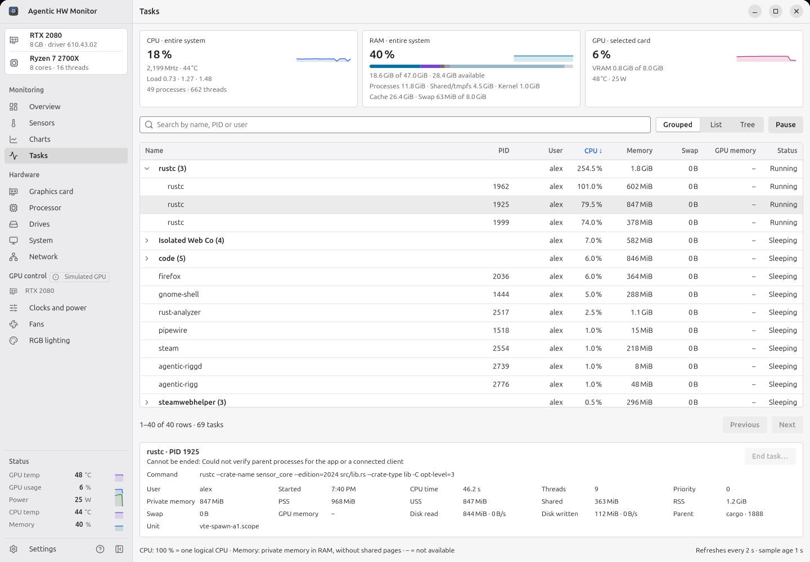

# Oppgavebehandling · forslag på feature/task-manager

Denne modulen utvikles og gjennomgås på `feature/task-manager`, med `main` som mål for en Draft PR. Den stabile utgaven er fortsatt 1.4.1 · bygg 24. Appversjon, nedlastingspakke og ny Release fastsettes ved en senere utgivelse; denne oppgaven autoriserer ingen merge eller installasjon på brukerens PC.

Faktisk appbilde (engelsk brukerflate) fra en privat GTK-økt mot en falsk `/proc` med oppdiktede prosesser og brukere (`app/scripts/bilder.sh --plan readme-oppgaver`). Det tidligere bildet viste maskinens egne prosesser og brukernavn og er fjernet.

## Målinger og avgrensing

Oppgaver utvider den eksisterende prøvetråden i `agentic-riggd`. Vinduet starter ingen egen maskinvareleser. Prosessoversikten leses ved behov; systemets CPU, RAM og GPU og grafene gjenbruker eksisterende telemetri/historikk.

| Felt | Betydning og begrensning |
|---|---|
| CPU per prosess | Endring i `utime + stime` fra `/proc/PID/stat`, delt på `_SC_CLK_TCK` og forløpt monoton tid. 100 % er én logisk CPU; en flertrådet prosess kan overstige 100 %. Første prøve og ny prosessidentitet har ukjent CPU. Barnas CPU-tid legges ikke til. |
| System-CPU | Eksisterende systemmåling med hele maskinen som 100 %. Den har dermed en annen nevner enn prosesskolonnen. |
| Minne per prosess (kolonnen «Minne») | Privat minne i RAM: `RssAnon` fra `/proc/PID/status` (heap, stakk og andre anonyme sider), det samme som «resident − delt» i `statm`, som GNOME Ressurser og Systemovervåker bruker. Feltet kan leses for alle prosesser, også root og andre brukere, og summen over alle prosesser ligger nær `AnonPages` i `/proc/meminfo`. Kjernetråder har ikke feltet og vises som –. |
| Swap per prosess | `VmSwap` fra `/proc/PID/status`: prosessens sider som er flyttet til swap. |
| RSS og delt | `RSS` (fra `stat`) er privat minne pluss delte sider og kan ikke summeres. `Delt` er `RssFile` + `RssShmem`. Begge står i detaljfeltet. |
| PSS og USS | Fra `/proc/PID/smaps_rollup`, bare for den valgte prosessen. PSS er privat minne pluss en rettferdig andel av delte sider; USS er sider bare prosessen bruker. Kjernen gir bare samme bruker eller root tilgang, så for andres prosesser står «ingen tilgang». Å lese `smaps_rollup` for alle prosesser kostet 0,77 s kjernetid per runde på utviklingsmaskinen, derfor gjøres det ikke i listen. For den valgte prosessen leses det i en egen kortlivet tråd (høyst én om gangen, 25–30 ms for 0,5 GB), aldri i tjenestens hovedløkke; svaret bruker siste avlesning, og feltet viser «leser …» til den første er klar. Detaljfeltet forklarer de tre minnetallene i en egen linje. |
| System-RAM | `/proc/meminfo`. Brukt = `MemTotal` − `MemAvailable`, som `free` og GNOME Ressurser. RAM-kortet deler brukt minne i prosesser (`AnonPages`), delt minne/tmpfs (`Shmem`, blant annet filer i `/tmp` og `/dev/shm`, som ikke tilhører en enkelt prosess), kjerne (`SUnreclaim` + `KernelStack` + `PageTables` + `Percpu` + `SecPageTables`) og annet brukt (resten, blant annet reserver kjernen holder av). Buffer/cache (`Buffers` + `Cached` − `Shmem` + `SReclaimable`) og swap vises for seg. Swap brukt kan være mye større enn summen av prosessenes `VmSwap`, fordi utflyttet tmpfs/delt minne også ligger der. |
| GPU-minne | Tilgjengelig prosess-VRAM fra den eksisterende NVML-prosessleseren. Manglende eller utilgjengelig verdi betyr ukjent, ikke 0. Simulerte GPU-PID-er kobles ikke til ekte prosesser. |
| GPU-belastning per prosess | Ikke levert av dagens prosessbackend. Systemets GPU-prosent tilordnes aldri en enkelt prosess. NVML har egne valgfrie API-er for dette, men støtte og manglende prøver krever en egen implementasjon. |
| Identitet | PID sammen med starttid i klokketikk etter oppstart. En ny prosess med samme PID arver verken CPU-baseline eller valgt avslutningsmål. |
| Prosessnavn | Kjernens prosessnavn; kan være avkortet. |
| Gruppering | Standardvisningen «Gruppert» samler prosessene med samme navn (alle `chrome` i én rad) og alle kjernetråder i én rad. Gruppen viser summen av CPU, minne, swap, GPU-minne og tråder for prosessene som passer søket; en gruppe med én prosess vises som prosessen selv. Grupper foldes ut med pilen eller Enter. En gruppe kan ikke avsluttes samlet. «Liste» og «Tre» viser hver prosess. |
| Detaljer for valgt prosess | Leses på forespørsel (`get_task_detail`) for den valgte prosessen, hvert andre sekund mens den er valgt: kommandolinje (`cmdline`), programfil (`exe`), bruker, starttid (`btime` + starttikk), samlet CPU-tid, tråder, nice, minnetallene over, disk-I/O (`read_bytes`/`write_bytes` fra `/proc/PID/io` og raten mellom to avlesninger), forelder og systemd-enhet fra cgroup. Felt kjernen nekter (`exe`, `smaps_rollup`, `io` for andres prosesser), merkes «ingen tilgang». Kommandolinjen vises bare i vinduet; den lagres, logges eller eksporteres ikke, og miljøvariabler leses ikke. Identiteten (PID + starttid) kontrolleres før og etter lesingen. |

Forsvunne prosesser og utilgjengelige `/proc`-filer er normale Linux-tilfeller. Et prosessøyeblikk er en gjennomlesing, ikke et atomisk bilde av hele maskinen. `hidepid`, containere og navnrom kan begrense hva som er synlig. Det vises ingen oppdiktede verdier for det som ikke kan leses.

## Kostnad og grensesnitt

Prosesslesing skjer høyst hvert andre sekund og opphører etter at behovet utløper. Ingen `ps`, `top`, `nvidia-smi` eller `smaps` startes/leses for hver prosessrunde. Minnefeltene kommer fra `status`, som allerede leses for UID-en, så listen bruker ingen ekstra filer. Den eksisterende NVML-prosessleseren gjenbrukes. Søking, sortering og trevisning bygger på et mellomlagret prosessøyeblikk; det skannes ikke på nytt for hvert tastetrykk eller sideskifte i tabellen.

Kolonnene regnes ut fra tabellens bredde, likt for overskriften og hver rad, så lange brukernavn eller tall aldri forskyver kolonnene. Bredden på hver kolonne følger skrift og den lengste oversatte overskriften. Når bredden ikke strekker til, skjules GPU-minne, så Swap og så Bruker; PID, CPU, Minne og Status står alltid, og tabellen ruller aldri sidelengs. Tabellen har maksimalt 100 gjenbrukte rader og 48 KiB per prosesside, med plass til metadata og protokollkonvolutten innen den eksisterende meldingsgrensen. Søk, sortering, prosesstre og sidevalg bruker samme mellomlagrede data. Bare tabellen trenger å rulle; målesammendrag, filtre og handlingslinje skal være synlige. På smale vinduer kan kolonnene rulles sidelengs. Eksisterende snarveier 1–9 og 0 beholder betydningen sin; Oppgaver får Ctrl+Shift+Esc.

## Avslutning

Avslutning krever at brukeren velger én konkret prosess og bekrefter navn/PID i en dialog. Hvorfor en prosess ikke kan avsluttes, står synlig i detaljfeltet, og en deaktivert «Avslutt oppgave» vises dempet, ikke rød. Det sendes bare SIGTERM. En mottatt signalforespørsel betyr at signalet er sendt, ikke at prosessen allerede har avsluttet. Det finnes ingen automatisk avslutning, tidsstyrt eskalering til SIGKILL, gruppeavslutning eller prosess-tre-avslutning.

Tjenesten kontrollerer identitet og tillatelser på nytt. `pidfd_open` og `pidfd_send_signal` binder signalet til prosessen og unngår vanlig PID-gjenbruk mellom kontroll og signal. Ingen vanlig `kill(PID)`-reserve brukes dersom pidfd ikke er tilgjengelig. Kernelens tillatelseskontroll gjelder fortsatt. GPU-hjelperen brukes ikke, og det gis ingen administratoropptrapping.

PID 1, root/andre brukere, kjernetråder, døde prosesser, appen/tjenesten, tilkoblede klienter og deres foreldreprosesser samt kjente kritiske økt-/systemprosesser avvises. Ufullstendig identitets- eller rettighetskontroll sperrer avslutning. Dette er et konservativt vern, ikke en fullstendig klassifikasjon av alle tjenester på enhver Linux-installasjon. Testfixturer med en annen filrot kan aldri sende ekte signaler.

## Kilder

- [Linux man-pages: proc_pid_stat(5)](https://man7.org/linux/man-pages/man5/proc_pid_stat.5.html): CPU-tellere, starttid, resident minne og begrensninger.
- [Linux man-pages: pidfd_open(2)](https://man7.org/linux/man-pages/man2/pidfd_open.2.html) og [pidfd_send_signal(2)](https://man7.org/linux/man-pages/man2/pidfd_send_signal.2.html): stabil prosessreferanse, signaler og tillatelser.
- [NVIDIA NVML: Device Queries](https://docs.nvidia.com/deploy/nvml-api/latest/api/group__nvmlDeviceQueries.html): prosesslister, prosessminne og valgfrie belastningsmålinger. Et eksisterende API innebærer ikke at alle GPU-er/drivere støtter det.

## Verifikasjon

Kontrollert på Ubuntu 26.04.1 amd64, Rust 1.93.1 og GTK 4.22.4. Resultatene gjelder denne featurebranchen og er ikke nye målinger av den publiserte 1.4.1-utgaven.

- Produksjonsbinærene er bygget med `CARGO_BUILD_JOBS=6 CARGO_TARGET_DIR=$HOME/.cache/rigg-build cargo build --release --locked --workspace`. Alle tre oppgir den uendrede kildeversjonen 1.4.1 · bygg 24. Ingen av dem er installert.
- Den private GTK-planen `oppgaver` bestod med produksjonsbinærene: søk/ingen treff, PID-sortering, prosesstre, pause, F5 etter utløpt behov, sideskifte og nytt oppslag, lyst/mørkt ved 1440×900 og 640×760 med stor skrift. Sammendrag, filter og handlingslinje ble kontrollert innen vinduet. Lange prosessnavn avkortes med verktøytips; på 640 px er sidelengs tabellrulling forventet.
- En privat runner startet sitt eget `sleep`-barn. GTK-dialogens Avbryt lot barnet fortsette; bekreftet avslutning ga SIGTERM, og barnet ble høstet av runneren. Ingen eksisterende brukerprosesser ble signalisert. Prøven bruker GTKs interne knapp-/tastestier; fysisk Wayland-pekerbruk er ikke verifisert.
- En kort, isolert sammenligning av produksjonsdaemonen med GPU-backend `ingen`, disker av og samme systemtelemetri i begge faser ga 0,10 % av én CPU uten prosessforespørsler og 3,25 % med forespørsel hvert andre sekund (20 sekunder per fase). RSS gikk fra omtrent 8,1 til 10,1 MiB. Median svartid for en side på 100 rader var 4,83 ms, største 4,95 ms; største observerte svar var 24 957 byte. Etter oppvarming var rundt 760 prosesser synlige. Dette er en kort måling på utviklingsmaskinen, ikke et generelt ytelsesløfte eller måling av hele GTK-appens ressursbruk.
- En egen lesende daemon med ekte NVML, tom hjelperrot og isolerte mapper leverte `gpuSource: nvml` og kjent prosess-VRAM for opptil fem rader i det observerte topp-100-utvalget. Den samme oppholdsprøven bekreftet at ny CPU-baseline starter som ukjent etter behovsutløp. Hele daemonen brukte i denne 20-sekundersfasen 5,55 % av én CPU og 34,6 MiB RSS; dette inkluderer eksisterende NVML-/systeminnsamling og er ikke et mål på modulens isolerte tilleggskostnad. Median sidesvar var 4,83 ms. Ingen GPU-skriving ble utført.
- Bygg og private økter kjørte med minnevakt: ingen tung jobb starter under 6 GiB `MemAvailable`, og egen jobb avbrytes under 5 GiB. Observerte tilgjengelige minnemengder var over 19 GiB, godt over kravet på 4 GiB.

`cargo clippy --workspace --all-targets -- -D warnings` er ren. `cargo test --workspace --no-fail-fast --quiet` ga **424 bestått, 4 ignorert og 0 feil**. De ignorerte fysiske maskinvaretestene er ikke aktivert. Enhets- og kontrakttestene dekker blant annet PID-gjenbruk, monotone CPU-deltaer, foreldet baseline, uleselige data og rettigheter, sykliske/dype trær, avgrensede svar, GPU-datakvalitet, behovsutløp og isolert SIGTERM til eget barn. `git diff --check` er ren.

For å gjenta visningskontrollen etter bygg: `RIGG_BIN="$HOME/.cache/rigg-build/release" app/scripts/bilder.sh --plan oppgaver /tmp/rigg-oppgaver-bilder`. Denne standardplanen sender ingen prosessignaler. Signalprøven over ble kjørt med en separat privat runner og en eksplisitt valgt egen testprosess; testkoden verifiserer at målet er `sleep` med samme runner som forelder.

GPU-prosent per prosess, en fysisk flerkortsmaskin, AMD/Intel-GPU, alternative skrivebord, containere/hidepid og belastningsprøver med titusener av prosesser er ikke verifisert. GPU-/viftekontroll og hjelperens sikkerhetsmotor er uendret. Ingen GPU-settere, I2C/RGB, brukerinstallasjon eller stabil Release inngår.

## Kontroll mot systemet (23. november 2026)

På utviklingsmaskinen ga leseren 498 rader (228 prosesser og 270 kjernetråder, med 26 root-prosesser og 15 fra andre systembrukere), mot 494 i `ps -e` noen sekunder senere. Summen av privat minne var 7 506 MiB mot `AnonPages` 7 360 MiB. Den største enkeltprosessen (gnome-shell) hadde 866 MiB privat og 980 MiB RSS, som i `ps`. Ingen enkeltprosess var over 1 GiB, men gruppen `chrome` (24 prosesser) brukte 2,9 GiB. Av 22 GiB brukt minne var 11 GiB `Shmem` (tmpfs i `/tmp`), og av 8 GiB swap var bare 1 GiB prosessenes egen `VmSwap`. `smem` er ikke installert.

